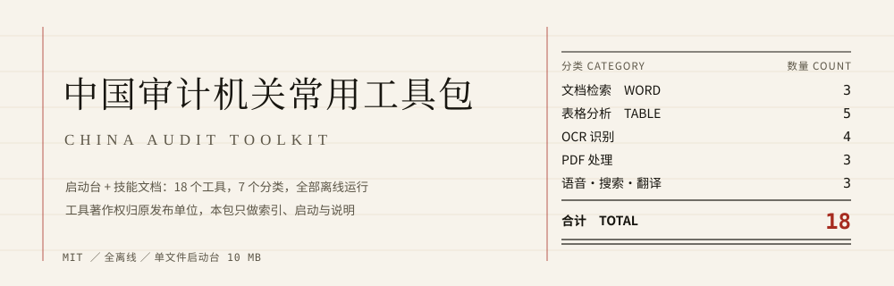

<p align="center">
  
</p>

<p align="center">
  <a href="https://github.com/wsy1022/china-audit-toolkit/releases"></a>
  <a href="https://github.com/wsy1022/china-audit-toolkit/actions/workflows/build.yml"></a>
  
  
</p>

<p align="center">
  A launcher and 18 Chinese skill documents for audit data work: Word/Excel/PDF handling,<br>
  local OCR, speech-to-text, and an English→Chinese translator for financial statements.
</p>

> **Scope note.** The tools themselves are Chinese-language utilities published by Chinese audit institutions, built for PRC audit practice (vouchers, invoices, bank statements, field notes). The skill documents, the launcher and the translator are ours. If you work with Chinese-language audit evidence, this repository is for you; if you do not, [`wsy1022/accounting-audit-en-zh`](https://github.com/wsy1022/accounting-audit-en-zh) is the part you probably want.

---

## What this is

A **launcher** — one 10 MB Windows exe — plus **18 skill documents**. The launcher reads `tools.json` and lays the tools out as cards by category: click 启动 to run one, 说明 to open its usage note. When a tool is not where the manifest says, the card degrades to "未找到程序" instead of failing silently.

The skill documents are written for AI coding agents (Claude Code, Codex, Hermes, …): each `SKILL.md` states when to reach for that tool, how to prepare the input, how to verify the output, and where it usually goes wrong.

## What this is not

- **It does not contain the audit tools' binaries.** Their copyright belongs to the publishers. This repository ships the manifest, the launcher, the skill documents and a verification script; you obtain the tools from their official channel and drop them under `组件/` at the paths in `tools.json`.
- It does not draw audit conclusions and does not replace professional judgement.
- The translator converts language only: no FX conversion, no unit scaling.

## The 18 tools

| # | Tool | What it does |
|---|---|---|
| 01 | 批量Word文档关键字检索 | Word · Batch keyword search across .docx, hits exported to Excel; regex supported |
| 01B | 批量Word检索(支持doc老格式) | Word · Same, including legacy .doc (converted via WPS/Office) |
| 07 | 文本文档比对工具 | Word · Side-by-side text diff with insert/delete highlighting |
| 02 | 数据分析关联查询工具 | Table · Left/right/inner/outer join of two Excel/CSV sheets |
| 03 | 表格数据关联工具 | Table · Sheets → relational tables, visual link builder, merged output |
| 12 | Excel单表拆分 | Table · Split one workbook by a field into many files |
| 13 | Excel多表合一 | Table · Merge many workbooks into one |
| 14 | Excel多页合表 | Table · Merge many sheets of one workbook into a single sheet |
| 04 | 图片文字识别工具 | OCR · Images and image-only PDFs → Word, local PaddleOCR |
| 08 | 发票识别工具 | OCR · Invoice images → structured table, local |
| 09 | 发票信息批量提取工具 | OCR · Batch PDF e-invoices → one table (Shanghai tax bureau format) |
| 10 | 身份证手机号识别工具 | OCR · ID card OCR; ID/mobile number attribution lookup, batch via Excel |
| 05 | PDF文件内容提取工具 | PDF · Body text → Word, tables → CSV |
| 06A | PDF数据提取工具 | PDF · PDF tables → Excel; first choice for bank statements |
| 06B | PDF文件转换工具 | PDF · Whole-document format conversion |
| 11 | 语音识别工具 | Speech · Audio → text, local sherpa-ncnn bilingual model, fully offline |
| S | 关键词搜索工具 | Search · Whole-disk document search with OCR, paragraph summaries, highlighted hits |
| 15 | 财务报表中英翻译器 | Translate · English financial statements → bilingual Word, term-locked |

## Using it

**The tools** — place the official packages under `组件/`, then double-click the launcher:

```
中国审计机关常用工具包.exe
```

**The skills** — copy the folders you need into your agent's skills directory:

```bash
cp -r skills/excel-split ~/.claude/skills/
```

Then ask: "split this voucher table by supplier, one file each". The agent follows `excel-split`: inspect the header and the split field first, split, then check that row counts are conserved.

**Verifying a toolbox** — checks paths, sizes and SHA-256 for all 22 files:

```bash
python scripts/verify_toolbox.py --root "E:\审计数据处理工具箱"
```

## Tool 15: the financial statement translator

Reading a foreign subsidiary's statements or a cross-border file means reading English statements in Chinese. Machine translation fails in three specific places — terms drift, figures disappear, rows shift — and the translator gates each one: 750 audit/accounting terms injected and re-checked after translation, every figure diffed against the source, and statement-like input handled line by line.

Source in `apps/translator/`, the exe in Releases, the full skill and glossary in [`wsy1022/accounting-audit-en-zh`](https://github.com/wsy1022/accounting-audit-en-zh).

## Adding your own tool

`tools.json` is the single source of truth — one entry, one more card:

```json
{
  "id": "16",
  "name": "往来款账龄分析",
  "cat": "表格分析",
  "desc": "按科目和账龄区间汇总往来款，输出账龄表。",
  "exe": "组件/自建工具/16往来款账龄分析/往来款账龄分析.exe",
  "help": "组件/说明/16往来款账龄分析.txt",
  "keywords": "账龄 往来 应收 应付"
}
```

An unknown `cat` creates a new category tab; `help` is opened with the system default program.

## Repository layout

```
china-audit-toolkit/
├── tools.json                    manifest: 18 tools
├── tools.sha256                  size + hash of 22 files (incl. 4 lite variants)
├── launcher/toolbox.py           launcher source (tkinter, single file)
├── skills/                       18 SKILL.md documents
│   ├── 00-overview/              which tool for which job
│   ├── word-keyword-search/ …    01 / 01B / 07 / S
│   ├── table-join/ …             02 / 03 / 12 / 13 / 14
│   ├── ocr-image/ …              04 / 08 / 09 / 10
│   ├── pdf-extract/ …            05 / 06A / 06B
│   ├── speech-to-text/           11
│   └── accounting-audit-en-zh/   15, with 750 terms and 155 sentence pairs
├── apps/translator/              translator source + term base
├── scripts/
│   ├── verify_toolbox.py         path / size / hash check
│   └── build_exe.bat             one-click launcher build
└── docs/                         banner, icon, screenshots
```

## Building the launcher yourself

```bash
pip install pyinstaller
cd launcher && pyinstaller --noconfirm --onefile --windowed \
  --name "中国审计机关常用工具包" --add-data "../tools.json;." --icon ../docs/app.ico toolbox.py
```

Output in `launcher/dist/`.

## Copyright and provenance

- The 21 audit-tool executables are **not** in this repository and remain the property of their publishers; this project ships an index and a launcher, nothing more.
- `tools.sha256` records values verified on the maintainer's machine — it tells you whether your copies were replaced or corrupted, and is not a licence.
- Our own code (launcher, translator, verification script) is MIT; the skill documents are CC BY 4.0.
- Details in [NOTICE.md](NOTICE.md).

<p align="center">
  <sub><a href="README.md">中文</a> · <b>English</b></sub>
</p>
